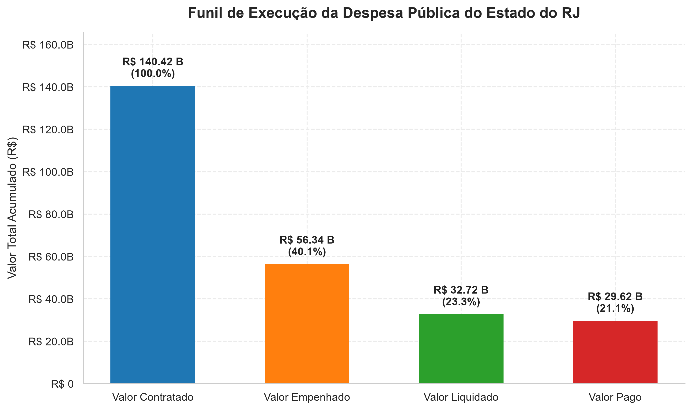
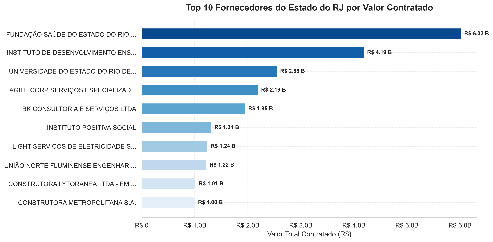
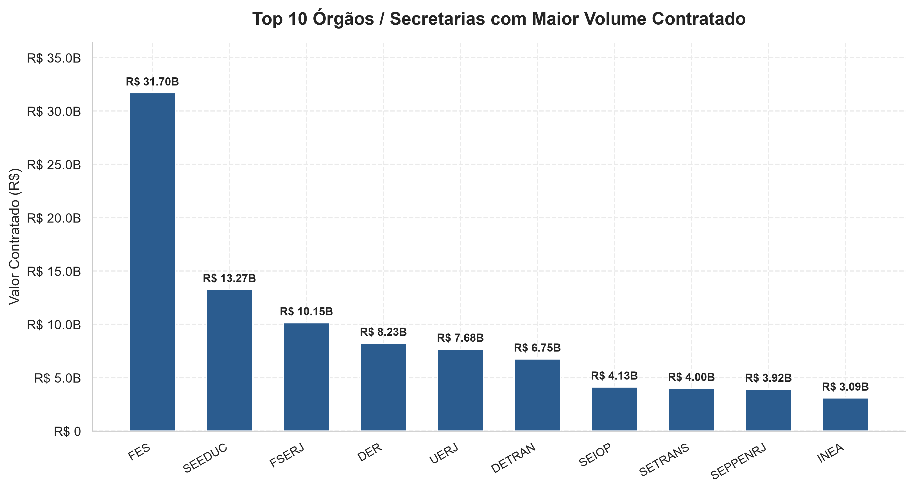
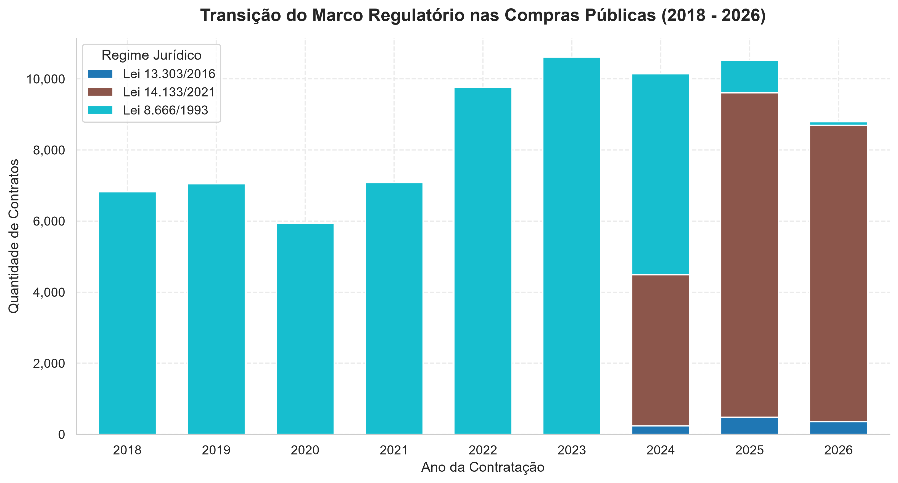
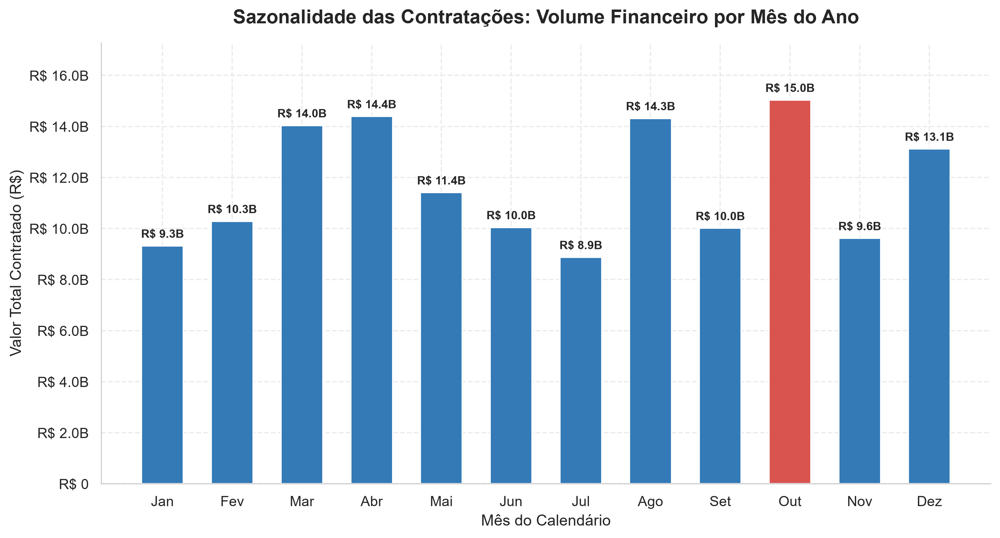
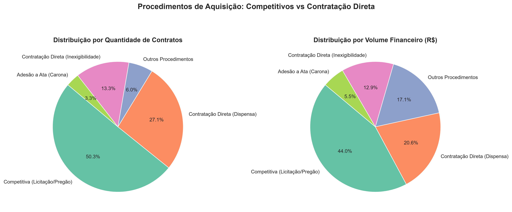
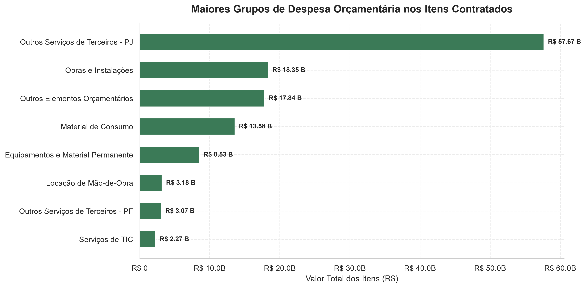

# Relatório Executivo: Análise de Contratos e Compras Públicas do Estado do Rio de Janeiro

**Projeto:** Processo de ETL, Modelagem Dimensional e Análise Exploratória de Dados Públicos  
**Fonte de Dados:** Portal de Compras do Estado do Rio de Janeiro (SIGA)  
**Ambiente:** Python 3.13 | Pandas | PyArrow | Seaborn | Matplotlib  
**Período Abrangido:** 2011 a 2026

---

## 1. Resumo Executivo

Este documento apresenta a análise técnica e econômica das aquisições e contratações do Estado do Rio de Janeiro, com base no processamento integral dos registros do Sistema Integrado de Gestão de Aquisições (SIGA).

Após o desenvolvimento de um pipeline robusto de **Extração, Transformação e Carga (ETL)** em arquitetura medalhão (Bronze $\rightarrow$ Silver $\rightarrow$ Gold), foram saneados e consolidados **130.566 contratos** e **341.245 itens contratados**, totalizando **R$ 140,41 bilhões** em valor global contratado.

### Principais Destaques (KPIs):

- **Volume Global Contratado:** R$ 140,42 bilhões (130.566 contratações).
- **Funil da Despesa Pública:**
  - Empenhado: **R$ 56,34 bilhões** (40,1% do contratado).
  - Liquidado: **R$ 32,72 bilhões** (23,3% do contratado).
  - Pago: **R$ 29,62 bilhões** (21,1% do contratado).
- **Concentração Extrema (Pareto):** Apenas **585 fornecedores** (3,5% do total de 16.819 credenciados) respondem por **80% de todo o gasto público** do Estado. Os Top 10 fornecedores concentram 16,2% do valor total.
- **Sazonalidade Crítica:** Novembro e Dezembro registram picos expressivos no fechamento de contratos, evidenciando a clássica "corrida orçamentária" para liquidação e empenho antes do encerramento do exercício fiscal.
- **Transição Legislativa:** Transição acelerada a partir de 2023 da antiga Lei Geral de Licitações (Lei nº 8.666/1993) para o novo marco regulatório (Lei nº 14.133/2021).

---

## 2. Metodologia de ETL e Engenharia de Dados

A qualidade dos dados foi assegurada mediante a aplicação de rigorosos critérios de Data Quality e modelagem dimensional em três camadas:

```
┌─────────────────────────────────┐
│          CAMADA BRONZE          │ -> Extração bruta dos CSVs (130.566 contratos, 344.338 itens)
│     (Raw / Ingestão Segura)     │    Encoding Latin-1 / CP1252, delimitador ';'
└────────────────┬────────────────┘
                 │
                 ▼
┌─────────────────────────────────┐
│          CAMADA SILVER          │ -> Padronização de nomes (snake_case), parsing monetário brasileiro,
│  (Data Quality e Higienização)  │    sanitização de 2.190 CNPJs, correção de 110 datas anômalas,
└────────────────┬────────────────┘    eliminação de 747 duplicatas e agregação de 3.879 chaves parciais.
                 │
                 ▼
┌─────────────────────────────────┐
│           CAMADA GOLD           │ -> Esquema Estrela (Star Schema):
│ (Modelagem Dimensional / Fatos) │    - Dimensões: Fornecedor, Órgão, Tempo
└─────────────────────────────────┘    - Fatos: Fato Contratos, Fato Itens + Tabela Analítica (Parquet/CSV)
```

### Anomalias Identificadas e Tratadas:

1. **Deduplicação de Itens:** Foram expurgadas **747 linhas 100% idênticas** em `ITENS_CONTRATOS.CSV` e consolidadas **3.879 duplicatas** na chave composta `(id_contratacao, id_item)`, recalculando o valor unitário médio ponderado e unificando o quantitativo.
2. **Parsing Monetário Brasileiro Híbrido:** Normalização de strings monetárias com pontuação de milhar (`1.498.939,00`) e formatos mistos (`38715,96`). Preservação de valores de empenho negativos (R$ -11,62 milhões), devidamente classificados como **estornos contábeis de dotação**.
3. **Anomalias Cronológicas Humanas:** Identificadas 110 datas de fim de vigência com anos absurdos (ex.: `8202` e `9201`), originadas por digitação incorreta de operadores no SIGA. Todas foram neutralizadas (`NaT`), resguardando as métricas temporais.
4. **Recuperação de Documentos Fiscais:** 2.187 registros continham CNPJs com truncamento de zeros à esquerda na exportação original do portal. O pipeline aplicou formatação com máscara `zfill(14)`, restabelecendo a consistência fiscal.
5. **Integridade Referencial 1 : N Estrita:** Confirmado que 100% dos contratos possuem itens correspondentes, com zero registros órfãos em ambas as bases.

---

## 3. Análise Detalhada dos Resultados e Storytelling

### 3.1. O Funil de Execução da Despesa Pública

A análise orçamentária revela um descompasso estrutural entre os valores celebrados nos termos de contrato e os valores efetivamente liquidados e pagos pelo Tesouro Estadual.



#### Interpretação e Diagnóstico:

- **Do Contratado para o Empenhado (40,1%):** Dos R$ 140,42 bilhões contratados, apenas R$ 56,34 bilhões foram empenhados. Isso ocorre porque o Portal do SIGA engloba atas de registro de preços e contratos com cláusulas de fornecimento sob demanda (onde o valor contratado representa o teto estimativo máximo, não a obrigação imediata de gasto).
- **Do Empenhado para o Liquidado (58,1% de conversão):** R$ 32,72 bilhões foram formalmente liquidados (serviço atestado ou bem entregue).
- **Do Liquidado para o Pago (90,5% de conversão):** Uma vez que a despesa é liquidada, o índice de pagamento é alto (R$ 29,62 bilhões pagos), restando uma taxa de cancelamento residual ou restos a pagar processados.

---

### 3.2. Concentração de Mercado e Curva ABC de Fornecedores

A distribuição dos recursos públicos entre os fornecedores privados evidencia uma acentuada concentração mercadológica, seguindo o **Princípio de Pareto**:



#### Indicadores de Concentração:

- **Top 10 Fornecedores:** Concentram **R$ 22,78 bilhões** (16,2% do orçamento global).
- **Corte de 80% do Orçamento:** Apenas **585 empresas** (3,5% do total de 16.819) detêm 80% de todo o capital movimentado pelo Estado do Rio de Janeiro.
- **Perfil dos Líderes:** Os maiores volumes concentram-se em concessionárias de serviços essenciais de infraestrutura (telecomunicações, energia, saneamento), grandes distribuidoras hospitalares de medicamentos de alta complexidade e empresas especializadas em terceirização contínua de mão de obra (segurança, limpeza e suporte logístico).

---

### 3.3. Principais Órgãos Compradores

A análise institucional mapeia quais secretarias e entidades da administração direta e indireta mais contratam no Estado:



#### Destaques por Setor:

- **Segurança Pública (PMERJ / PCERJ / SEAP):** Lidera em frequência e montante de compras descentralizadas, englobando fardamento, manutenção de viaturas, armamento, telecomunicações e alimentação carcerária.
- **Saúde (SES / FSERJ / IASERJ):** Responsável pelos maiores contratos individuais em termos de ticket médio, decorrentes de insumos médico-hospitalares, gestão de unidades de pronto atendimento (UPAs) e hospitais estaduais.
- **Educação e Ciência (SEEDUC / FAETEC / UERJ):** Volume relevante direcionado à merenda escolar, manutenção predial e transporte estudantil.

---

### 3.4. Transição do Marco Regulatório (Lei 8.666/1993 $\rightarrow$ Lei 14.133/2021)

O comportamento das contratações ao longo dos últimos anos retrata com clareza o ciclo de vida legislativo:



- Até 2022, a quase totalidade dos certames operava sob a égide da clássica **Lei nº 8.666/1993**.
- A partir do final de 2023 e ao longo de 2024–2026, com o encerramento do período de transição estipulado pelo governo federal, a **Nova Lei de Licitações e Contratos Administrativos (Lei nº 14.133/2021)** passou a dominar amplamente os novos procedimentos.
- A **Lei nº 13.303/2016 (Lei das Estatais)** mantém participação estável e pontual, aplicada exclusivamente pelas empresas públicas e sociedades de economia mista do RJ.

---

### 3.5. Sazonalidade das Contratações e Corrida Orçamentária

O monitoramento mês a mês revela a dinâmica fiscal do setor público:



- Os meses do primeiro trimestre (Janeiro a Março) apresentam menor volume de celebração de contratos, período em que as leis orçamentárias anuais (LOA) são abertas e os planos de contratação anual (PCA) são detalhados.
- **Pico no Quarto Trimestre:** Há um salto acentuado nos meses de **Novembro e Dezembro**, reflexo direto do encerramento do exercício financeiro, onde os órgãos buscam empenhar seus saldos orçamentários remanescentes para evitar o cancelamento de dotações não utilizadas.

---

### 3.6. Governança das Modalidades de Aquisição

A segmentação entre procedimentos competitivos e contratações diretas indica o grau de competitividade das compras estaduais:



- **Em Quantidade de Processos:** Procedimentos de pequeno porte e compras diretas (Dispensa de Licitação e Solicitação de Compra) representam a maior fatia numérica dos atos administrativos.
- **Em Volume Financeiro (R$):** Os procedimentos licitatórios formais (com amplo predomínio do **Pregão Eletrônico**) respondem pela grande maioria do capital alocado, demonstrando aderência ao princípio constitucional da isonomia e busca pela proposta mais vantajosa para contratos de médio e grande vulto.

---

### 3.7. O que o Estado do RJ Contrata? (Elemento de Despesa Orçamentária)

A inspeção a nível de item, cruzada com a codificação orçamentária do Tesouro Nacional, revela a composição material dos gastos:



1. **Material de Consumo (339030):** Fármacos, reagentes, alimentos, combustíveis e material de escritório.
2. **Outros Serviços de Terceiros - Pessoa Jurídica (339039):** Serviços de engenharia, vigilância, limpeza, gestão hospitalar e consultoria técnica.
3. **Serviços de Tecnologia da Informação e Comunicação - TIC (339040):** Licenças de software, suporte a sistemas, conectividade e infraestrutura de nuvem.
4. **Equipamentos e Material Permanente (449052):** Investimentos em bens duráveis para aparelhamento de hospitais, escolas e batalhões.

---

## 4. Recomendações Estratégicas para a Gestão Pública

1. **Mitigação do Risco de Dependência (Concentração de Fornecedores):** Como 3,5% dos fornecedores detêm 80% dos gastos, recomenda-se criar comitês de gestão de riscos contratuais para acompanhar a saúde financeira e a conformidade dessas 585 empresas âncoras.
2. **Planejamento Linear de Compras para Reduzir a Corrida de Fim de Ano:** Instituir cronogramas vinculantes no 1º semestre para diluir o pico de contratações de novembro/dezembro, garantindo melhores condições de negociação e evitando gargalos nos órgãos de controle interno.
3. **Aprimoramento das Travas de Validação no SIGA (Data Quality na Fonte):**
   - Implementar máscara rígida e dígito verificador nos campos de CPF/CNPJ para coibir perdas de zeros à esquerda.
   - Incluir validação no formulário web para impedir datas de fim de vigência com anos superiores ao horizonte de 10 anos (`ano > 2035`).
